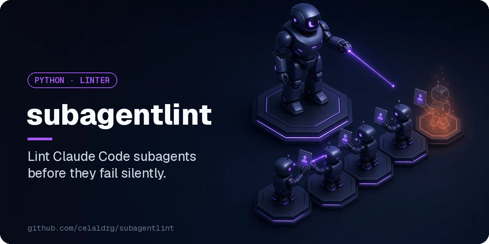
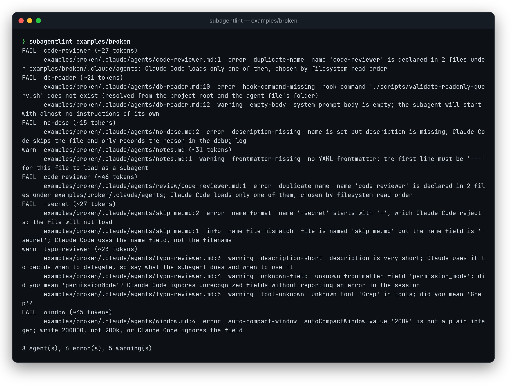

<p align="center">
  
</p>

<p align="center">
  <a href="https://github.com/celaldrg/subagentlint/actions/workflows/ci.yml"></a>
  
  
  
  <a href="https://github.com/celaldrg/subagentlint/releases"></a>
</p>

**Lint Claude Code subagents before they fail silently.**

Custom subagents live in `.claude/agents/*.md`. Claude Code skips a file with broken frontmatter, a missing `description`, or a `name` that starts with `-`, and it ignores a typo such as `permission_mode` or `disallowTools` without showing an error in the session. The reason, if it is recorded at all, ends up in the debug log. `subagentlint` checks those files in your editor or in CI, against the [published subagent format](https://code.claude.com/docs/en/sub-agents).

- Catches the mistakes that prevent a subagent from loading: invalid YAML, missing `name`/`description`, illegal names, unclosed frontmatter.
- Flags fields and tool names Claude Code will ignore, with typo suggestions (`permission_mode` → `permissionMode`, `Grap` → `Grep`).
- Checks hook scripts exist and are executable, skills resolve, and inline MCP servers have a `command` or `url`.
- Reports duplicate names in the same agents tree (only one will load), names that override built-ins, and combined `description` fields that exceed the 15,000-token startup budget.
- Text, JSON and GitHub Actions annotation output. Zero dependencies, Python 3.10+.

<p align="center">
  
  <br><sub>Real output: <code>subagentlint examples/broken</code></sub>
</p>

## Install

```bash
pip install git+https://github.com/celaldrg/subagentlint@v0.1.0
# or grab the wheel from the v0.1.0 release
```

## Usage

```bash
subagentlint                       # discover .claude/agents in the current repo
subagentlint .claude/agents        # one agents folder
subagentlint path/to/reviewer.md   # one file
subagentlint --user                # also scan ~/.claude/agents
subagentlint --strict              # warnings fail too
subagentlint --format json         # machine-readable
subagentlint --format github       # GitHub Actions annotations
subagentlint --ignore unknown-field
subagentlint --list-rules
```

Exit codes: `0` clean, `1` errors (or warnings with `--strict`), `2` nothing found or a bad path.

## Example

<p align="center">
  
  <br><sub>Recorded with <a href="https://github.com/charmbracelet/vhs">vhs</a>.</sub>
</p>

Running it on this repo's [`examples/broken`](examples/broken):

```text
$ subagentlint examples/broken
FAIL  code-reviewer (~27 tokens)
      examples/broken/.claude/agents/code-reviewer.md:1  error  duplicate-name  name 'code-reviewer' is declared in 2 files under examples/broken/.claude/agents; Claude Code loads only one of them, chosen by filesystem read order
FAIL  db-reader (~21 tokens)
      examples/broken/.claude/agents/db-reader.md:10  error  hook-command-missing  hook command './scripts/validate-readonly-query.sh' does not exist (resolved from the project root and the agent file's folder)
      examples/broken/.claude/agents/db-reader.md:12  warning  empty-body  system prompt body is empty; the subagent will start with almost no instructions of its own
FAIL  no-desc (~15 tokens)
      examples/broken/.claude/agents/no-desc.md:2  error  description-missing  name is set but description is missing; Claude Code skips the file and only records the reason in the debug log
warn  examples/broken/.claude/agents/notes.md (~31 tokens)
      examples/broken/.claude/agents/notes.md:1  warning  frontmatter-missing  no YAML frontmatter: the first line must be '---' for this file to load as a subagent
FAIL  code-reviewer (~46 tokens)
      examples/broken/.claude/agents/review/code-reviewer.md:1  error  duplicate-name  name 'code-reviewer' is declared in 2 files under examples/broken/.claude/agents; Claude Code loads only one of them, chosen by filesystem read order
FAIL  -secret (~27 tokens)
      examples/broken/.claude/agents/skip-me.md:2  error  name-format  name '-secret' starts with '-', which Claude Code rejects; the file will not load
      examples/broken/.claude/agents/skip-me.md:1  info  name-file-mismatch  file is named 'skip-me.md' but the name field is '-secret'; Claude Code uses the name field, not the filename
warn  typo-reviewer (~23 tokens)
      examples/broken/.claude/agents/typo-reviewer.md:3  warning  description-short  description is very short; Claude uses it to decide when to delegate, so say what the subagent does and when to use it
      examples/broken/.claude/agents/typo-reviewer.md:4  warning  unknown-field  unknown frontmatter field 'permission_mode'; did you mean 'permissionMode'? Claude Code ignores unrecognized fields without reporting an error in the session
      examples/broken/.claude/agents/typo-reviewer.md:5  warning  tool-unknown  unknown tool 'Grap' in tools; did you mean 'Grep'?
FAIL  window (~45 tokens)
      examples/broken/.claude/agents/window.md:4  error  auto-compact-window  autoCompactWindow value '200k' is not a plain integer; write 200000, not 200k, or Claude Code ignores the field

8 agent(s), 6 error(s), 5 warning(s)
```

A clean tree, such as [`examples/ok`](examples/ok), prints `ok` and exits `0`.

## Rules

| Rule | Level | What it catches |
| --- | --- | --- |
| `frontmatter-missing`, `frontmatter`, `frontmatter-parse` | warning / error | No opening `---`, unclosed frontmatter, or YAML that does not parse |
| `name-missing`, `name-format`, `name-length` | error | Missing name, a name that starts with `-` or contains `:`, or a name longer than 256 characters |
| `name-builtin` | warning | Name overrides a built-in such as `Explore` or `Plan` |
| `description-missing` | error | A named file has no description, so Claude Code skips it silently |
| `description-short`, `description-budget` | warning | A description too short to guide delegation, or combined descriptions over 15,000 tokens |
| `unknown-field` | warning | A field Claude Code does not recognize and will ignore, with a typo suggestion |
| `permission-mode`, `memory-value`, `isolation-value`, `color-value`, `effort-value` | error | Invalid enum values |
| `model-unknown` | warning | Model is not `sonnet`, `opus`, `haiku`, `fable`, `inherit` or a `claude-…` id |
| `max-turns`, `auto-compact-window`, `bool-field`, `cache-ttl` | error | Wrong types or values, including `autoCompactWindow: 200k` |
| `tool-unknown` | warning | A tool name that is not a known built-in, with a typo suggestion |
| `skill-missing` | warning | A preloaded skill was not found under `.claude/skills` |
| `hook-event`, `hook-type`, `hook-command-missing`, `hook-not-executable` | warning / error | Unknown hook events, missing scripts, scripts without an execute bit |
| `mcp-server` | error | Inline MCP servers missing a `command` (stdio) or `url` (http/sse/ws) |
| `empty-body`, `body-long` | warning | No system prompt, or a prompt that is very large |
| `duplicate-name` | error | Two files in the same agents tree share a name; only one will load |
| `name-shadow` | warning | The same name exists in another agents tree and may be shadowed |
| `name-file-mismatch` | info | The filename does not match the `name` field (Claude Code uses the field) |

Skip a rule with `--ignore`. `subagentlint --list-rules` prints the full table.

## GitHub Actions

```yaml
- uses: actions/setup-python@v5
  with: { python-version: "3.12" }
- run: pip install git+https://github.com/celaldrg/subagentlint@v0.1.0
- run: subagentlint --format github
```

With `--format github`, problems show up as annotations on the pull request diff.

## In Python

```python
from subagentlint import lint_paths

result = lint_paths([".claude/agents"])
for finding in result.findings:
    print(finding.path, finding.line, finding.level, finding.rule, finding.message)
```

## Credits

The rules follow Anthropic's published [Claude Code subagent documentation](https://code.claude.com/docs/en/sub-agents). subagentlint is an independent project and is not affiliated with Anthropic.

## License

[MIT](LICENSE)
